# Fieldnotes development log

Dates show when each package version first appeared in the repository. Screenshots use sample data from test runs and Codex session captures. Select a preview to see the larger capture. “Before” labels identify the earlier build.

## In development

### 0.37.0

- Swipe the map card to compare sights or hotels. Back reveals the selected place in the list with a “Viewed on map” marker. The Map button stays in reach as you scroll.
- In this simulator build, saving dates for a hotel farther down the list can return you to the first result.

| Before · 0.36.0                                                                                                                                                                                                         | After · 0.37.0                                                                                                                                                                                             |
| ----------------------------------------------------------------------------------------------------------------------------------------------------------------------------------------------------------------------- | ---------------------------------------------------------------------------------------------------------------------------------------------------------------------------------------------------------- |
| [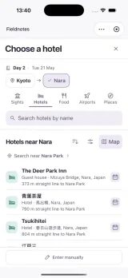](./docs/screenshots/0.37.0-before-returning-to-mapped-hotel.webp) | [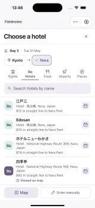](./docs/screenshots/0.37.0-return-to-mapped-hotel.webp) |

## 24 November 2026

### 0.36.0

- Tap a planned stop or checkout hotel on the results map to search around it. The day’s route stays visible even when the search finds no places.

| Before · 0.35.0                                                                                                                                                                                                            | After · 0.36.0                                                                                                                                                                                     | Nearby results                                                                                                                                                                                       |
| -------------------------------------------------------------------------------------------------------------------------------------------------------------------------------------------------------------------------- | -------------------------------------------------------------------------------------------------------------------------------------------------------------------------------------------------- | ---------------------------------------------------------------------------------------------------------------------------------------------------------------------------------------------------- |
| [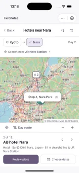](./docs/screenshots/0.36.0-before-searching-from-day-route-pin.webp) | [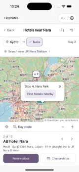](./docs/screenshots/0.36.0-search-hotels-from-park.webp) | [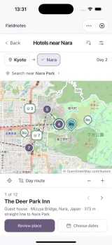](./docs/screenshots/0.36.0-hotels-centered-on-nara-park.webp) |

### 0.35.0

- See each date’s cities when choosing hotel nights. Moving a place to another day keeps its city selected when available. A shared map pin lets you switch between search results and planned stops.

| Before · 0.34.0                                                                                                                                                                                                   | After · 0.35.0                                                                                                                                                                                                             |
| ----------------------------------------------------------------------------------------------------------------------------------------------------------------------------------------------------------------- | -------------------------------------------------------------------------------------------------------------------------------------------------------------------------------------------------------------------------- |
| [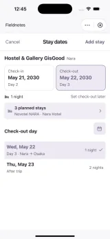](./docs/screenshots/0.35.0-before-city-route-on-stay-dates.webp) | [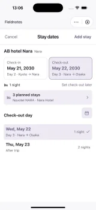](./docs/screenshots/0.35.0-see-city-route-on-stay-dates.webp) |

### 0.34.0

- Tap a crowded pin on either map and choose a place by name, even when two venues share an address.

| Before · 0.33.0                                                                                                                                                                        | After · 0.34.0                                                                                                                                                                                          | Choose a hotel                                                                                                                                                                                                    |
| -------------------------------------------------------------------------------------------------------------------------------------------------------------------------------------- | ------------------------------------------------------------------------------------------------------------------------------------------------------------------------------------------------------- | ----------------------------------------------------------------------------------------------------------------------------------------------------------------------------------------------------------------- |
| [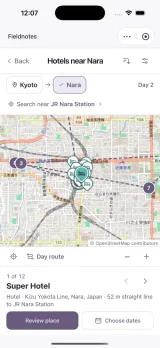](./docs/screenshots/0.34.0-before-shared-map-pin.webp) | [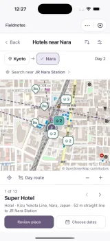](./docs/screenshots/0.34.0-group-overlapping-map-pins.webp) | [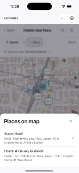](./docs/screenshots/0.34.0-choose-a-shared-map-pin.webp) |

### 0.33.0

- From the day map, tap a hotel to find nearby sights or a sight or station to find hotels. Return to the same pin after adding a place.

| Station pin                                                                                                                                                                                     | Nearby hotels                                                                                                                                                                                  |
| ----------------------------------------------------------------------------------------------------------------------------------------------------------------------------------------------- | ---------------------------------------------------------------------------------------------------------------------------------------------------------------------------------------------- |
|  | [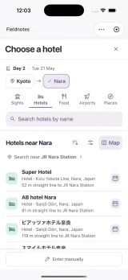](./docs/screenshots/0.33.0-hotels-near-day-map-station.webp) |

### 0.32.0

- From the itinerary, find hotels near a sight or station, or sights near a hotel. Overnight stays and checkouts use the hotel’s city even after the trip has moved on.

| Before · 0.31.0                                                                                                                                                                                                  | After · 0.32.0                                                                                                                                                                                    |
| ---------------------------------------------------------------------------------------------------------------------------------------------------------------------------------------------------------------- | ------------------------------------------------------------------------------------------------------------------------------------------------------------------------------------------------- |
| [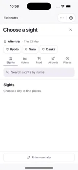](./docs/screenshots/0.32.0-before-checkout-sight-search.webp) | [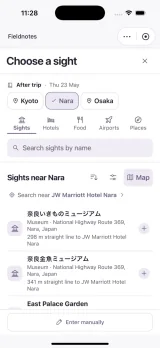](./docs/screenshots/0.32.0-nearby-sights-from-checkout.webp) |

### 0.31.0

- Compare a proposed stay with hotels already planned for the same nights. See the dates, cities and notes together before choosing.

| Before · 0.30.0                                                                                                                                                                                             | After · 0.31.0                                                                                                                                                                                        | Compare stays                                                                                                                                                                                            |
| ----------------------------------------------------------------------------------------------------------------------------------------------------------------------------------------------------------- | ----------------------------------------------------------------------------------------------------------------------------------------------------------------------------------------------------- | -------------------------------------------------------------------------------------------------------------------------------------------------------------------------------------------------------- |
| [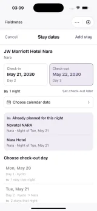](./docs/screenshots/0.31.0-before-planned-stay-comparison.webp) | [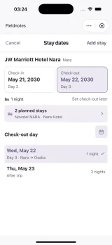](./docs/screenshots/0.31.0-select-overlap-details.webp) | [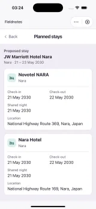](./docs/screenshots/0.31.0-compare-planned-stays.webp) |

### 0.30.0

- Browse previously saved places by city while offline. Check-ins use the place’s local time, including daylight-saving changes.

| Before · 0.29.0                                                                                                                                                                                       | After · 0.30.0                                                                                                                                                                        |
| ----------------------------------------------------------------------------------------------------------------------------------------------------------------------------------------------------- | ------------------------------------------------------------------------------------------------------------------------------------------------------------------------------------- |
| [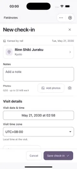](./docs/screenshots/0.30.0-before-local-time-check-in.webp) | [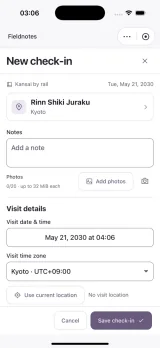](./docs/screenshots/0.30.0-local-time-check-in.webp) |

### 0.29.0

- Check in from a planned stop with its place and city filled in. Add notes or photos to a hotel on an overnight or checkout day.

| Before · 0.28.0                                                                                                                                                                    | After · 0.29.0                                                                                                                                                                               | Hotel journal                                                                                                                                                                                                   |
| ---------------------------------------------------------------------------------------------------------------------------------------------------------------------------------- | -------------------------------------------------------------------------------------------------------------------------------------------------------------------------------------------- | --------------------------------------------------------------------------------------------------------------------------------------------------------------------------------------------------------------- |
| [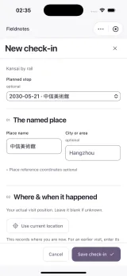](./docs/screenshots/0.29.0-before-prefilled-check-in.webp) | [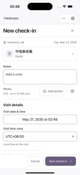](./docs/screenshots/0.29.0-prefill-place-and-city.webp) | [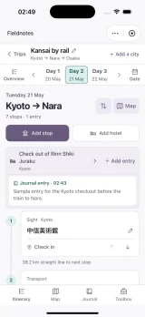](./docs/screenshots/0.29.0-check-in-at-checkout.webp) |

### 0.28.0

- See occupied nights when choosing hotel dates. Trip overview names arrivals, overnight stays and checkouts, and the itinerary offers **Add overnight stay** on an open night.

| Before · 0.27.0                                                                                                                                                                                                                | After · 0.28.0                                                                                                                                                                                                 | Trip overview                                                                                                                                                                                                                 |
| ------------------------------------------------------------------------------------------------------------------------------------------------------------------------------------------------------------------------------ | -------------------------------------------------------------------------------------------------------------------------------------------------------------------------------------------------------------- | ----------------------------------------------------------------------------------------------------------------------------------------------------------------------------------------------------------------------------- |
| [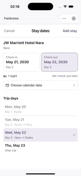](./docs/screenshots/0.28.0-before-occupied-hotel-nights.webp) | [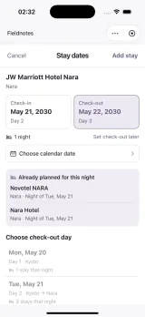](./docs/screenshots/0.28.0-show-occupied-hotel-nights.webp) | [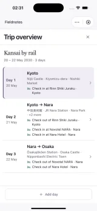](./docs/screenshots/0.28.0-lodging-in-trip-overview.webp) |

### 0.27.0

- Undo the most recent sight, manually entered stop or hotel from the list, map or itinerary. Undoing a hotel removes the whole stay.

[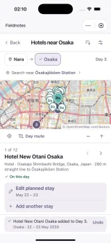](./docs/screenshots/0.27.0-undo-hotel-stay.webp)

### 0.26.0

- Choose a planned stop or hotel as the center of a three-kilometer search for sights or lodging.

| Choose the search area                                                                                                                                                                                       | Nearby results                                                                                                                                                                                              |
| ------------------------------------------------------------------------------------------------------------------------------------------------------------------------------------------------------------ | ----------------------------------------------------------------------------------------------------------------------------------------------------------------------------------------------------------- |
| [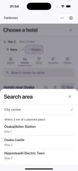](./docs/screenshots/0.26.0-choose-search-area.webp) | [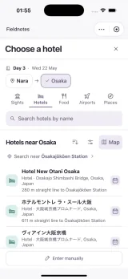](./docs/screenshots/0.26.0-hotels-centered-on-osakajokoen.webp) |

### 0.25.0

- Sort sights and hotels by straight-line distance to the nearest place in the day’s plan. The map remembers which result you selected in each city.

[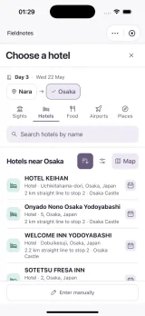](./docs/screenshots/0.25.0-sort-hotels-by-route.webp)

### 0.24.0

- Tapping a search result now opens its visitor details first. Add the sight, choose hotel dates or edit the proposed stop from there.

### 0.23.0

- Open visitor details to check a venue’s address, hours, admission, wheelchair access and website when available.

| Before · 0.22.0                                                                                                                                                                        | After · 0.23.0                                                                                                                                                                                                          |
| -------------------------------------------------------------------------------------------------------------------------------------------------------------------------------------- | ----------------------------------------------------------------------------------------------------------------------------------------------------------------------------------------------------------------------- |
| [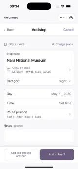](./docs/screenshots/0.23.0-before-museum-details.webp) | [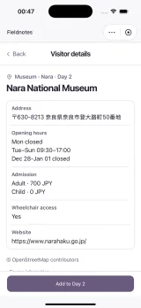](./docs/screenshots/0.23.0-museum-visitor-details.webp) |

### 0.22.0

- Get live sight and hotel suggestions as you type. Airport names and codes also autocomplete offline.

[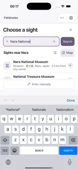](./docs/screenshots/0.22.0-live-museum-search.webp)

## 23 November 2026

### 0.21.0

- Open stay dates from a hotel’s calendar button in the list or on the map. Add a sight directly from a name search with **＋**.

| Before · 0.20.0                                                                                                                                                                                 | Calendar shortcut                                                                                                                                                                                               | After · 0.21.0                                                                                                                                                                                                |
| ----------------------------------------------------------------------------------------------------------------------------------------------------------------------------------------------- | --------------------------------------------------------------------------------------------------------------------------------------------------------------------------------------------------------------- | ------------------------------------------------------------------------------------------------------------------------------------------------------------------------------------------------------------- |
| [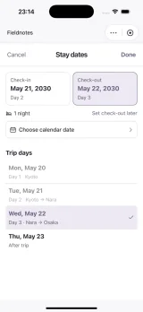](./docs/screenshots/0.20.0-choose-stay-dates.webp) | [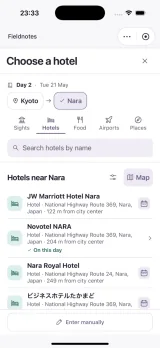](./docs/screenshots/0.21.0-open-dates-from-hotel-result.webp) | [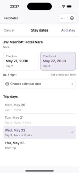](./docs/screenshots/0.21.0-confirm-hotel-from-results.webp) |

### 0.20.0

- Choose check-in and checkout together using itinerary days, their cities and the number of nights. Moving arrival carries the length of the stay forward.

### 0.19.0

- Drag stops or tap a handle to choose their order. The numbered map previews each move before you tap **Done**.

[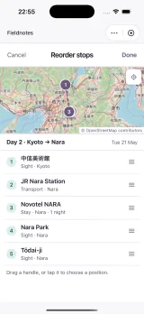](./docs/screenshots/0.19.0-reorder-day-route.webp)

### 0.18.0

- On a transfer day, a new sight goes before stops in a later city when the route follows city order. You can pick a different position before saving.

| Suggested position                                                                                                                                                                                           | Saved itinerary                                                                                                                                                                       |
| ------------------------------------------------------------------------------------------------------------------------------------------------------------------------------------------------------------ | ------------------------------------------------------------------------------------------------------------------------------------------------------------------------------------- |
| [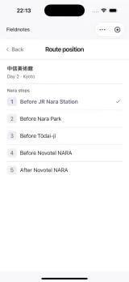](./docs/screenshots/0.18.0-insert-sight-in-city-order.webp) | [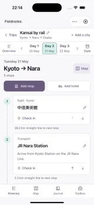](./docs/screenshots/0.18.0-save-stop-in-city-order.webp) |

### 0.17.0

- Filter a city’s sights and lodging by type, such as museums, gardens or guesthouses. The same filter applies to the list and map.

[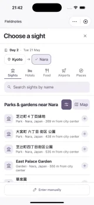](./docs/screenshots/0.17.0-filter-parks-and-gardens.webp)

### 0.16.0

- Finishing a save brings the stop back into view. A hotel appears on each overnight day and on checkout.

[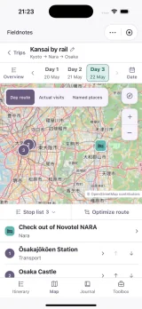](./docs/screenshots/0.16.0-show-checkout-on-day-map.webp)

### 0.15.0

- Compare search results with the numbered day route on a map. Switch between the day’s cities to review sights or lodging in either one.

[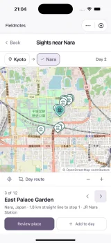](./docs/screenshots/0.15.0-compare-sights-on-map.webp)

### 0.14.0

- Add a sight with **＋**, or use **Add and choose another** after reviewing a place. The picker keeps your search and position.

| Quick-add a sight                                                                                                                                                                                          | Save a hotel                                                                                                                                                                   | Keep browsing                                                                                                                                                                                     |
| ---------------------------------------------------------------------------------------------------------------------------------------------------------------------------------------------------------- | ------------------------------------------------------------------------------------------------------------------------------------------------------------------------------ | ------------------------------------------------------------------------------------------------------------------------------------------------------------------------------------------------- |
| [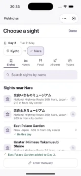](./docs/screenshots/0.14.0-quick-add-sight.webp) | [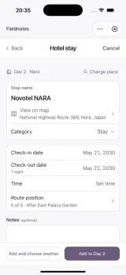](./docs/screenshots/0.14.0-add-hotel-and-continue.webp) | [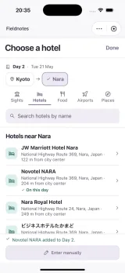](./docs/screenshots/0.14.0-continue-browsing-hotels.webp) |

### 0.13.0

- Choose where a stop fits between its neighbors before saving. Move a saved stop and preview its new position on the map.

| Choose a position                                                                                                                                                                                  | Preview it on the map                                                                                                                                                                       | Saved route                                                                                                                                                                           |
| -------------------------------------------------------------------------------------------------------------------------------------------------------------------------------------------------- | ------------------------------------------------------------------------------------------------------------------------------------------------------------------------------------------- | ------------------------------------------------------------------------------------------------------------------------------------------------------------------------------------- |
| [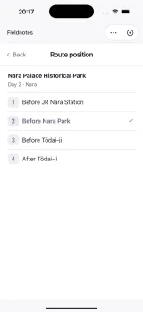](./docs/screenshots/0.13.0-choose-route-position.webp) | [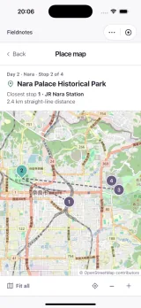](./docs/screenshots/0.13.0-preview-route-position.webp) | [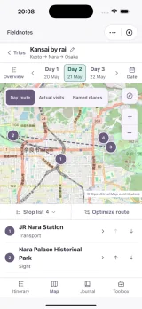](./docs/screenshots/0.13.0-save-route-position.webp) |

### 0.12.0

- Preview a candidate stop alongside the day’s route. If the place is already planned, reopen that visit or add a separate one.

### 0.11.0

- Switch cities without losing each city’s sight or hotel search. Saved places retain their planning city, and the trip library is searchable by name or city.

[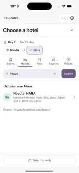](./docs/screenshots/0.11.0-keep-city-search.webp)

### 0.10.0

- **Add stop** starts in the day’s first city and **Add hotel** in its last. Switch cities on a transfer day and give a hotel its arrival and departure dates.

| Before · 0.9.0                                                                                                                                                                                                            | After · 0.10.0                                                                                                                                                                                                | Hotel review                                                                                                                                                                              |
| ------------------------------------------------------------------------------------------------------------------------------------------------------------------------------------------------------------------------- | ------------------------------------------------------------------------------------------------------------------------------------------------------------------------------------------------------------- | ----------------------------------------------------------------------------------------------------------------------------------------------------------------------------------------- |
| [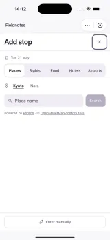](./docs/screenshots/0.10.0-before-transfer-day-picker.webp) | [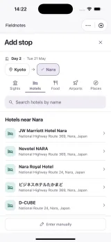](./docs/screenshots/0.10.0-choose-hotels-on-transfer-day.webp) | [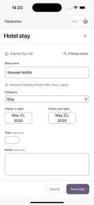](./docs/screenshots/0.10.0-review-hotel-dates.webp) |

### 0.9.0

- Search for sights, food and hotels near either city on a transfer day and save their map positions. Search cities and airports offline by name, alternate spelling or airport code.

## 22 November 2026

### 0.8.0

- Assign a transfer day when adding a city, see each day’s route in Trip overview and reorder stops on the map. Added the [Kyoto, Kansai and Singapore example trips](fixtures/README.md).

| Trip overview                                                                                                                                                                                              | Transfer day                                                                                                                                                             |
| ---------------------------------------------------------------------------------------------------------------------------------------------------------------------------------------------------------- | ------------------------------------------------------------------------------------------------------------------------------------------------------------------------ |
|  |  |

### 0.7.1

- Tapping the first city now saves a one-city trip and opens its itinerary immediately. **Add city** extends the trip later.

### 0.7.0

- Start a trip by picking a city offline or entering a custom name. Add and arrange more cities in travel order.

### 0.6.0

- Choose the first and last stops when optimizing a day’s route. The trip toolbox adds a packing checklist and expenses totaled by currency.

### 0.5.0

- Fieldnotes became a day-by-day planner. Arrange stops, see them numbered on the map and check in at a stop or on a detour. Existing journal entries and photo events carry over.

## 18 November 2026

### 0.4.0

- Group imported photos into events using capture times and GPS. Review each group, edit its optional AI-suggested title and save it to a trip.

## 17 November 2026

### 0.3.1

- Bundled the Fieldnotes icon with the app so the Apell launcher can display its official artwork.

### 0.3.0

- Introduced the Fieldnotes icon and adopted Apell’s light and dark themes.

## 7 November 2026

### 0.2.2

- Trip and check-in editors open full screen on mobile. Trip actions open beside the menu button.

| Trip menu                                                                                                                                                                                      | Full-screen editor                                                                                                                                                    |
| ---------------------------------------------------------------------------------------------------------------------------------------------------------------------------------------------- | --------------------------------------------------------------------------------------------------------------------------------------------------------------------- |
|  |  |

### 0.2.1

- Compact headers gave the timeline and map more room. Empty journals hide the search and visit count.

| Before · 0.2.0                                                                                                                                                                | After · 0.2.1                                                                                                                                                                                 |
| ----------------------------------------------------------------------------------------------------------------------------------------------------------------------------- | --------------------------------------------------------------------------------------------------------------------------------------------------------------------------------------------- |
|  |  |

### 0.2.0

- Added mobile Timeline and Map tabs, grouped visits by local date and carried the trip filter between views.

### 0.1.0

- The first Fieldnotes journal collected trips, check-ins, notes and photos. Each visit could record its own GPS position and link to a reusable named place.

