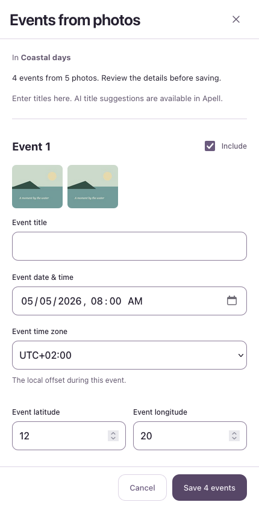
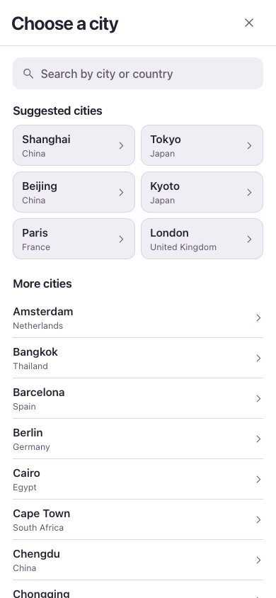
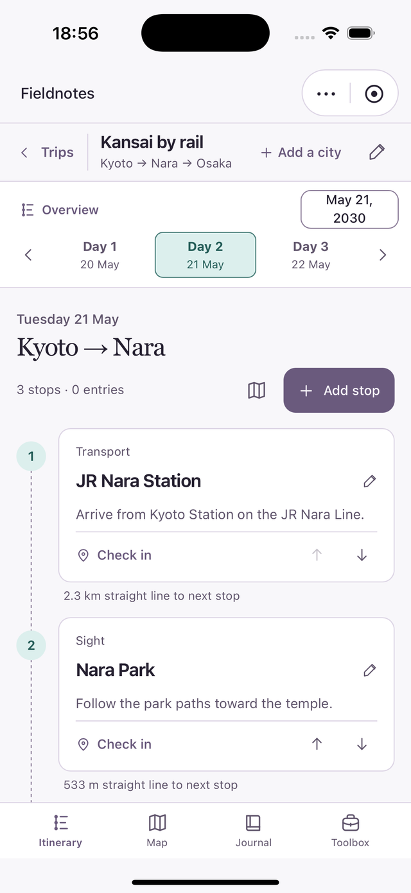
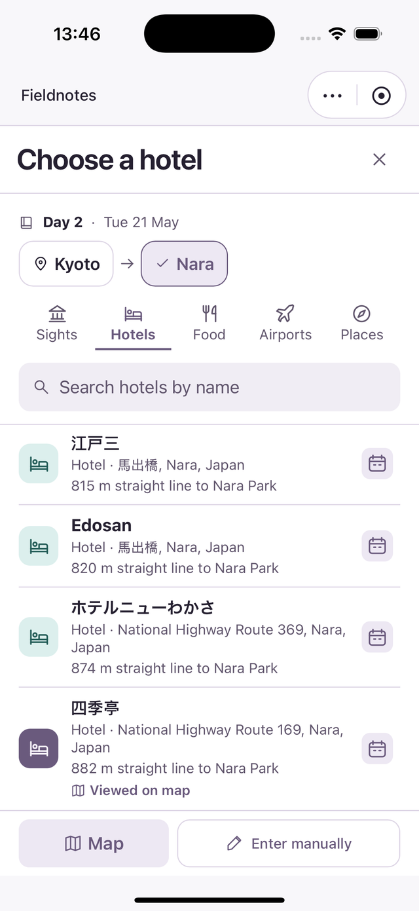

# Fieldnotes development log

Each entry records a Fieldnotes package version. Dates are when the version first appeared in the repository. The [screenshots](#screenshots) follow the planner from photo review to choosing a hotel on a transfer day.

## In development

- **0.37.0** — Swipe the map card to compare sights or hotels. Back reveals the selected place in the list with a “Viewed on map” marker. The Map button stays in reach as you scroll.
  - In this simulator build, saving dates for a hotel farther down the list can return you to the first result.

## 24 November 2026

- **0.36.0** — Tap a planned stop or checkout hotel on the results map to search around it. The day’s route stays visible even when the search finds no places.
- **0.35.0** — See each date’s cities when choosing hotel nights. Moving a place to another day keeps its city selected when available. A shared map pin lets you switch between search results and planned stops.
- **0.34.0** — Tap a crowded pin on either map and choose a place by name, even when two venues share an address.
- **0.33.0** — From the day map, tap a hotel to find nearby sights or a sight or station to find hotels. Return to the same pin after adding a place.
- **0.32.0** — From the itinerary, find hotels near a sight or station, or sights near a hotel. Overnight stays and checkouts use the hotel’s city even after the trip has moved on.
- **0.31.0** — Compare a proposed stay with hotels already planned for the same nights. See the dates, cities and notes together before choosing.
- **0.30.0** — Browse previously saved places by city while offline. Check-ins use the place’s local time, including daylight-saving changes.
- **0.29.0** — Check in from a planned stop with its place and city filled in. Add notes or photos to a hotel on an overnight or checkout day.
- **0.28.0** — See occupied nights when choosing hotel dates. Trip overview names arrivals, overnight stays and checkouts, and the itinerary offers **Add overnight stay** on an open night.
- **0.27.0** — Undo the most recent sight, manually entered stop or hotel from the list, map or itinerary. Undoing a hotel removes the whole stay.
- **0.26.0** — Choose a planned stop or hotel as the center of a three-kilometer search for sights or lodging.
- **0.25.0** — Sort sights and hotels by straight-line distance to the nearest place in the day’s plan. The map remembers which result you selected in each city.
- **0.24.0** — Tapping a search result now opens its visitor details first. Add the sight, choose hotel dates or edit the proposed stop from there.
- **0.23.0** — Open visitor details to check a venue’s address, hours, admission, wheelchair access and website when available.
- **0.22.0** — Get live sight and hotel suggestions as you type. Airport names and codes also autocomplete offline.

## 23 November 2026

- **0.21.0** — Open stay dates from a hotel’s calendar button in the list or on the map. Add a sight directly from a name search with **＋**.
- **0.20.0** — Choose check-in and checkout together using itinerary days, their cities and the number of nights. Moving arrival carries the length of the stay forward.
- **0.19.0** — Drag stops or tap a handle to choose their order. The numbered map previews each move before you tap **Done**.
- **0.18.0** — On a transfer day, a new sight goes before stops in a later city when the route follows city order. You can pick a different position before saving.
- **0.17.0** — Filter a city’s sights and lodging by type, such as museums, gardens or guesthouses. The same filter applies to the list and map.
- **0.16.0** — Finishing a save brings the stop back into view. A hotel appears on each overnight day and on checkout.
- **0.15.0** — Compare search results with the numbered day route on a map. Switch between the day’s cities to review sights or lodging in either one.
- **0.14.0** — Add a sight with **＋**, or use **Add and choose another** after reviewing a place. The picker keeps your search and position.
- **0.13.0** — Choose where a stop fits between its neighbors before saving. Move a saved stop and preview its new position on the map.
- **0.12.0** — Preview a candidate stop alongside the day’s route. If the place is already planned, reopen that visit or add a separate one.
- **0.11.0** — Switch cities without losing each city’s sight or hotel search. Saved places retain their planning city, and the trip library is searchable by name or city.
- **0.10.0** — **Add stop** starts in the day’s first city and **Add hotel** in its last. Switch cities on a transfer day and give a hotel its arrival and departure dates.
- **0.9.0** — Search cities and airports offline by name, alternate spelling or airport code. Find sights, food and hotels near either city on a transfer day and save their map positions.

## 22 November 2026

- **0.8.0** — Assign a transfer day when adding a city, see each day’s route in Trip overview and reorder stops on the map. Added the [Kyoto, Kansai and Singapore example trips](fixtures/README.md).
- **0.7.1** — Tapping the first city now saves a one-city trip and opens its itinerary immediately. **Add city** extends the trip later.
- **0.7.0** — Start a trip by picking a city offline or entering a custom name. Add and arrange more cities in travel order.
- **0.6.0** — Choose the first and last stops when optimizing a day’s route. The trip toolbox adds a packing checklist and expenses totaled by currency.
- **0.5.0** — Fieldnotes became a day-by-day planner. Arrange stops, see them numbered on the map and check in at a stop or on a detour. Existing journal entries and photo events carry over.

## 18 November 2026

- **0.4.0** — Group imported photos into events using capture times and GPS. Review each group, edit its optional AI-suggested title and save it to a trip.

## 17 November 2026

- **0.3.1** — Bundled the Fieldnotes icon with the app so the Apell launcher can display its official artwork.
- **0.3.0** — Introduced the Fieldnotes icon and adopted Apell’s light and dark themes.

## 7 November 2026

- **0.2.2** — Trip and check-in editors open full screen on mobile. Trip actions open beside the menu button.
- **0.2.1** — Compact headers gave the timeline and map more room. Empty journals hide the search and visit count.
- **0.2.0** — Added mobile Timeline and Map tabs, grouped visits by local date and carried the trip filter between views.
- **0.1.0** — The first Fieldnotes journal collected trips, check-ins, notes and photos. Each visit could record its own GPS position and link to a reusable named place.

## Screenshots

Photo review and First city use later mobile test captures to illustrate those early features. The other screenshots show sample trips on the Apell iPhone simulator. Select a screenshot for a larger view.

| Photo review · 0.4.0                                                                                                                                                                                             | First city · 0.7.1                                                                                                                                                                                                 |
| ---------------------------------------------------------------------------------------------------------------------------------------------------------------------------------------------------------------- | ------------------------------------------------------------------------------------------------------------------------------------------------------------------------------------------------------------------ |
|  |  |
| Review the time and location before saving a photo group.                                                                                                                                                        | Pick the city that opens the new trip.                                                                                                                                                                             |

| Transfer day · 0.8.0                                                                                                                                                                                           | Route reordering · 0.19.0                                                                                                                                                                                   |
| -------------------------------------------------------------------------------------------------------------------------------------------------------------------------------------------------------------- | ----------------------------------------------------------------------------------------------------------------------------------------------------------------------------------------------------------- |
|  |  |
| Kyoto and Nara share one day’s itinerary.                                                                                                                                                                      | Drag a stop while its numbered pin updates.                                                                                                                                                                 |

| Visitor details · 0.23.0                                                                                                                                                                                                               | Overlapping hotel nights · 0.31.0                                                                                                                                                                                       |
| -------------------------------------------------------------------------------------------------------------------------------------------------------------------------------------------------------------------------------------- | ----------------------------------------------------------------------------------------------------------------------------------------------------------------------------------------------------------------------- |
|  |  |
| Check the museum’s details before adding it to the day.                                                                                                                                                                                | See which hotels share a night with the proposed stay.                                                                                                                                                                  |

| Nearby hotel search · 0.36.0                                                                                                                                                                                   | Return from the map · 0.37.0 in development                                                                                                                                                                                        |
| -------------------------------------------------------------------------------------------------------------------------------------------------------------------------------------------------------------- | ---------------------------------------------------------------------------------------------------------------------------------------------------------------------------------------------------------------------------------- |
|  |  |
| Move the hotel search from JR Nara Station to Nara Park.                                                                                                                                                       | Return to 四季亭 and choose its stay dates from the list.                                                                                                                                                                          |
